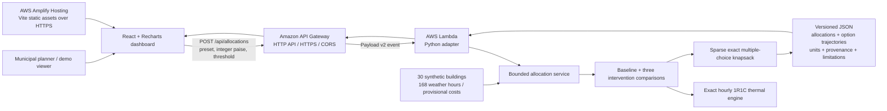

# HeatShield architecture

HeatShield separates scientific calculation, transport and presentation. The deployed demonstration uses a synthetic preset; no household data is transmitted or stored.

## System diagram



The working deployment is reported by the project owner and the adapter is supported by repository code. [Public asset, API and browser checks](VERIFICATION.md) verify observable behavior, not private AWS runtime, IAM policy, memory, throttling or log-retention settings. CloudWatch/configuration recommendations in Phase 5 notes are not evidence of deployed settings.

## Responsibilities

| Layer / file | Responsibility |
|---|---|
| `frontend/src/App.jsx`, `components/` | Controls, requests, authoritative summaries, allocation table, temperature dialog and disclosures |
| `frontend/src/api.js`, `format.js` | HTTPS configuration, JSON requests, exact INR-to-paise conversion and display formatting |
| AWS Amplify Hosting | Static HTML, JavaScript and CSS over HTTPS; no Python execution |
| Amazon API Gateway | Public route, Lambda integration and browser CORS; cloud settings managed separately |
| `heatshield/api/lambda_handler.py` | Payload-v2 parsing, path/media/body checks and compact strict JSON responses |
| `heatshield/api/allocations.py` | Transport-independent service, allowlisted preset, resource bounds and structured errors |
| `heatshield/api/server.py` | Loopback-only local HTTP adapter; not the production server |
| `heatshield/presets.py` | Deterministic synthetic municipal inputs and illustrative costs |
| `heatshield/contracts.py`, `scenarios.py` | Provenance, validated contracts, comparisons and response assembly |
| `heatshield/interventions.py` | Pure absorptance, resistance and irradiance transformations |
| `heatshield/thermal.py` | Heat balance, exact hourly integration and overheating proxy |
| `heatshield/optimization.py` | Integer allocation, deterministic ties and state-limit failure |
| `scripts/package_*.py`, `frontend/scripts/` | Lambda/frontend ZIPs and local/public verification |
| `scripts/audit_tasgaonkar.py`, `docs/research/` | Separate dataset investigation; no calibration or validation of this demo |

There is no database, authentication, upload, persistent allocation history or cross-building thermal coupling.

## Request to result

1. The frontend converts decimal INR text with integer `BigInt` arithmetic, then sends a bounded JSON-safe integer number of paise and the threshold.
2. Requests use `/api/allocations` through Vite locally, or the build-time `VITE_API_BASE_URL` HTTPS origin in production.
3. The transport passes JSON bytes to the same service. Duplicate keys, nonstandard numeric literals and oversized bodies are rejected.
4. The server constructs the preset. Each baseline is simulated once; three interventions use the same initial state and horizon.
5. Comparisons yield signed avoided K·h, nonnegative integer scores and exact minor-unit costs. The optimizer selects one option including baseline for every building.
6. The response contains authoritative totals and option trajectories. The UI formats totals and looks up selected curves; it does not recompute financial totals or scores.

### Public contract

`POST /api/allocations`, `Content-Type: application/json`:

```json
{"preset_id":"synthetic_municipal_v1","budget_minor":7500000,"threshold_c":30}
```

Exactly these keys are accepted. Budget is an integer, not a boolean, from 0 to 100,000,000 paise inclusive (INR 10,00,000 maximum). Threshold is finite, 15–45 °C inclusive; this is not a health recommendation. Decoded body limit: 4096 bytes. Preset guards: 50 buildings, 168 hours per building and three nonbaseline options maximum. Current preset: 30 buildings. Candidate state cap: 50,000.

Success schema `heatshield.phase3a.v1` includes:

- `preset_id`, `currency`, `units`, threshold, horizon, metric and score conventions.
- Unique `weather` and `buildings` with IDs, parameters, provenance and every option's cost, signed benefit and simulation.
- `allocation.selections`, integer budget/spent/remaining minor units, score string and peak working states.
- `summary`, `solver_settings`, `assumptions` and structured `limitations`.

Selections reference options without repeating trajectories. Each option retains indoor and sol-air arrays; the compact default response is roughly 0.8 MB. Score integers are decimal strings. Infinite time constants become `null` with a flag; nonfinite JSON numbers are disallowed. Array values are end-of-hour samples at relative hours 1–168; initial temperature is separate.

Errors use `{"error":{"code":"...","message":"...","fields":{}}}`. Application errors cover malformed JSON (400), path/method (404/405), size/media type (413/415), validation or state exhaustion (422), and internal failures (500). Gateway errors may have a different envelope. No failed computation returns a partial allocation as success.

## Deployment boundaries

Live frontend: https://staging.d22u8i6a71q15e.amplifyapp.com/

API origin: https://hdt6pym543.execute-api.ap-southeast-2.amazonaws.com

The API hostname is in `ap-southeast-2`. API Gateway owns preflight/CORS; the adapter adds no CORS headers. CORS is not authentication. Input/state bounds limit individual computations; account-level throttling, concurrency, IAM and costs need separate AWS inspection.

The API origin is public build-time configuration. Root `amplify.yml` prepares optional GitHub builds, without proving that pipeline is enabled. Packaging and tests create no AWS resources. Preserve the working hosting origin and CORS configuration.

See [deployment preparation](phase5.md) and [Amplify asset incident](amplify_frontend.md). This submission update does not change cloud configuration.
